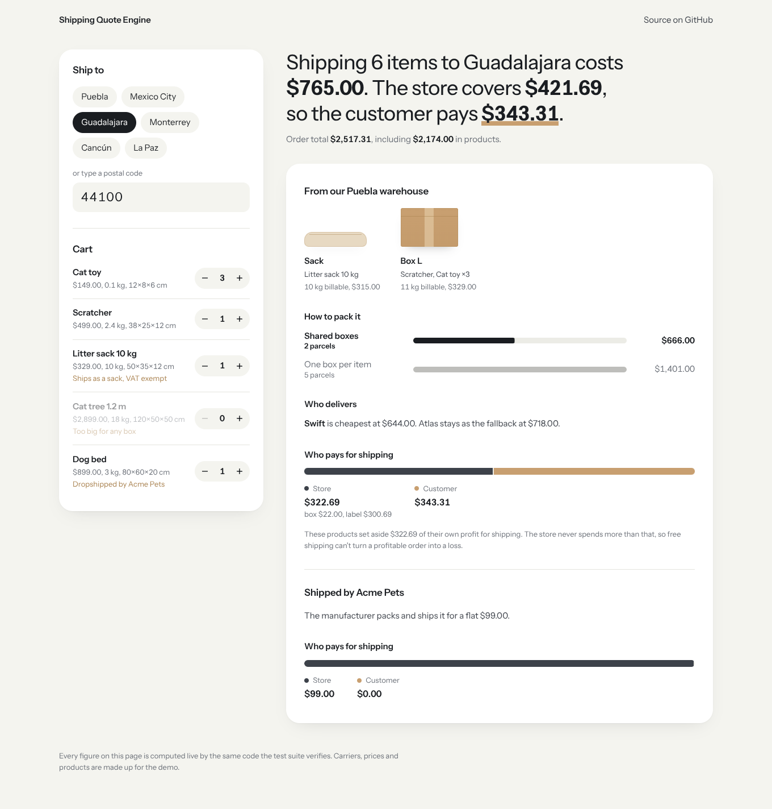
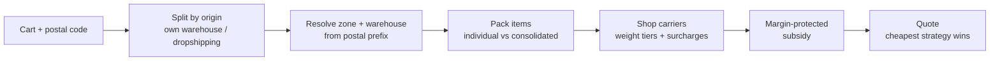

# shipping-quote-engine

[](https://github.com/MoraHernan07/shipping-quote-engine/actions/workflows/ci.yml)


A shipping quote engine for e-commerce checkouts. Given a cart and a postal code, it decides **which warehouse ships**, **how to box the items**, **which carrier is cheapest**, and **how much of the shipping the store can absorb without losing money**.

The logic is extracted and rewritten from the order system behind an e-commerce store I built and run in production. Every carrier, price and box in this repo is sample data.

**[Try the live playground →](https://morahernan07.github.io/shipping-quote-engine/)** Change the cart and the postal code and watch the engine re-quote instantly, in your browser.





## Quick start

```bash
npm install
npm run demo         # prints two example quotes in the terminal
npm run playground   # opens the interactive React playground locally
npm run check        # lint + typecheck + tests with coverage + playground build
```

```ts
import { createQuoteEngine } from 'shipping-quote-engine';

const engine = createQuoteEngine(config); // validates the config once, throws ConfigError with every issue
const quote = engine.quote(
  [{ product: catToy, quantity: 3 }, { product: litterSack, quantity: 1 }],
  '44100',
);

quote.totals; // { productsCents, shippingCostCents, subsidyCents, customerShippingCents }
```

Demo output (Guadalajara, mixed cart with a dropshipped item):

```text
Warehouse puebla: strategy "consolidated", 2 parcel(s)
  - sack [LIT-020] 10 kg billable
  - box L [SCR-010, TOY-001, TOY-001, TOY-001] 11 kg billable
  carrier swift $644.00 (runner-up atlas $718.00)
  options: consolidated $666.00 | individual $1401.00
  subsidy pool $322.69, used $322.69, customer pays $343.31

Manufacturer acme-pets: flat fee $99.00
  subsidy pool $131.15, used $99.00, customer pays $0.00
```

## How it works

| Step | Module | What it does |
|---|---|---|
| Split | `split.ts` | Separates own-warehouse items from items each manufacturer ships directly. Each group is its own shipment. |
| Route | `zones.ts` | The first two digits of a Mexican postal code identify the state. The state maps to a rate zone and a serving warehouse. |
| Pack | `packing.ts` | Adds 30 mm of padding per side, picks boxes, and tries two strategies: one box per unit, and consolidated (First-Fit Decreasing). Sacks ship as they are; items too big for any box ship in their own packaging. |
| Weigh | `weight.ts` | Billable weight = max(real, volumetric), rounded up to whole kilos. Volumetric grams = mm³ / divisor, exactly. |
| Rate | `rates.ts` | Prices every parcel with every carrier using weight tiers, adds oversize surcharges, and keeps the winner and the runner-up. |
| Subsidize | `subsidy.ts` | Each unit funds shipping with a share of its **own** profit. The pool pays packaging first, then the label. The customer pays the rest. |
| Quote | `quote.ts` | Runs both packing strategies end to end and keeps the cheapest total. |

## Zones, not cities

Carriers price by **rate zone**, not by city, so two cities in the same zone get the same quote. In the demo data, Guadalajara and Monterrey are both `national`, and Cancún and La Paz are both `remote`. Mexico City is the only destination with its own warehouse, so it ships from there; everything else ships from Puebla. Zones are plain config: moving a state to another zone is a one-line change in `examples/example-config.ts`.

## Design decisions

**Integer money, integer units.** Money is in cents, weight in grams, length in millimeters. There are no floats anywhere in the pricing path, so `0.1 + 0.2` problems cannot leak into a price. Rounding is explicit and always in the safe direction: fees round up, discounts round down.

**Margin-protected subsidy.** Free shipping is funded per unit:

```text
net profit   = price without VAT − cost − gateway fee
contribution = net profit × subsidy %   (0 if the unit loses money)
subsidy      = min(Σ contributions, packaging + label)
```

So the subsidy can never exceed the profit set aside for it. This is checked by a property test against hundreds of random carts.

**An honest packing heuristic.** Exact 3D bin packing is NP-hard. For quoting, the engine checks three things per box: each item fits in some rotation, total padded volume stays under 85% of the inner volume, and weight stays under the payload limit. It estimates cost well; it is not a loading plan. The engine prices both strategies and keeps the cheaper one, so a bad consolidation can never make a quote worse than packing items one by one.

**Pure functions and fail-fast config.** Nothing does I/O. Rate tables, boxes and zones are plain data, validated once by `createQuoteEngine`, which reports every problem at the same time. Requests that cannot be quoted throw a typed `QuoteError` (`UNKNOWN_POSTAL_CODE`, `NO_CARRIER_AVAILABLE`…) so the checkout can fall back to a manual quote.

**Deterministic output.** Ties are broken by id everywhere, so the same cart always gets the same quote, which makes quotes reproducible and auditable.

## Testing

- **Unit tests** for every module, with hand-checked numbers (VAT, fees, tiers, surcharges, box sizes).
- **Property-based tests** with [fast-check](https://fast-check.dev): hundreds of random carts per property. Among them:
  - every unit lands in exactly one parcel;
  - no box exceeds its payload, and every boxed item fits once padded;
  - billable weight is never below the real or volumetric weight;
  - the subsidy never exceeds the profit set aside, and never turns a profitable cart into a loss;
  - the chosen strategy is always the cheapest, and totals add up.
- **CI** on Node 20 and 22: lint (typescript-eslint strict), typecheck, tests with coverage thresholds, build.

## Playground

`playground/` is a small React + Vite app that imports the engine straight from `src/`, so the page runs the exact code the tests verify. There is no backend: every quote is computed in the browser on each change. It deploys to GitHub Pages on every push to `main` (`.github/workflows/pages.yml`).

## Known limitations

- The gateway fee is modeled on the product price; a fee on the shipping charge itself is out of scope.
- Rate tables are static data; live carrier APIs would plug in where `shopCarriers` reads `config.rates`.
- Postal codes resolve by state prefix, which is enough for zone pricing but not for last-mile exclusions.

## License

MIT
